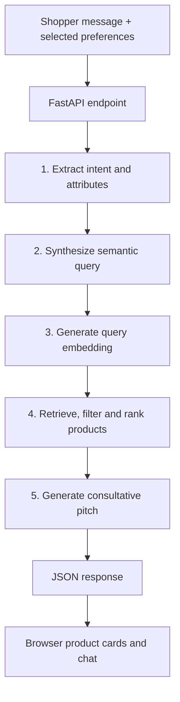

# ApnaMart AI Sales Associate (ApnaMart Sahayak)

A conversational e-commerce product-discovery assistant. It converts a shopper's natural-language request into structured preferences, retrieves relevant catalogue items, and generates a consultative recommendation.

**Core idea:** make product discovery feel more like speaking to a helpful store associate than filling in a long search form.

> This repository is an educational/demo implementation. The included catalogue is a local snapshot of 103 product records; it is not a live inventory connection. Prices, stock, ratings and product links should be verified against the retailer before real-world use.

## What it does

A shopper can ask something like:

> "I need a navy-blue men's suit, size M, for an interview, under ₹4,000."

The application attempts to:
1. identify the product category and preferences;
2. turn the request into a compact semantic search sentence;
3. encode that sentence as a 768-dimensional vector;
4. rank catalogue items using vector similarity and available metadata filters;
5. generate a short sales-associate response with the leading matches.

The project includes a browser interface, a FastAPI backend, a LangGraph workflow, a local product catalogue, and optional Groq / Hugging Face API integrations.

## Architecture



### The five workflow stages

| Stage | What it means | Main implementation |
|---|---|---|
| 1. Intent extraction | Find category, subcategory, size, colour, occasion and constraints from the request | `backend/pipeline.py` |
| 2. Query synthesis | Rewrite the request as a descriptive sentence for retrieval | `backend/groq_service.py` |
| 3. Query embedding | Convert text into a numeric vector | `backend/embedding_service.py` |
| 4. Retrieval and ranking | Compare query and product vectors; apply supported filters | `backend/pipeline.py` |
| 5. Pitch generation | Explain recommendations in a helpful sales-associate tone | `backend/groq_service.py` |

LangGraph connects these stages as a directed state graph. The state carries the request, extracted attributes, query sentence, embedding, retrieved products, response and trace logs between nodes.

## Technology

- **Python** – application and retrieval logic
- **FastAPI** – HTTP API
- **LangGraph** – multi-step stateful workflow
- **Groq API (optional)** – LLM-based query synthesis and response generation
- **Hugging Face Inference API (optional)** – `sentence-transformers/all-mpnet-base-v2` embeddings
- **NumPy** – vector normalization and similarity calculations
- **HTML, CSS and JavaScript** – browser interface

The application contains fallback/simulation paths when optional API credentials are not configured. These fallbacks are useful for demonstrating the flow, but they should not be described as equivalent to a production semantic embedding model or a live LLM.

## Repository layout

```text
ApnaMart-AI-Sales-Associate/
├── backend/
│   ├── main.py                 # FastAPI routes and application setup
│   ├── pipeline.py             # Main five-stage LangGraph pipeline
│   ├── embedding_service.py    # Query embeddings and fallback
│   ├── groq_service.py         # Optional LLM calls and fallback responses
│   └── catalog_builder.py     # Catalogue preparation utilities
├── ecommerce_agent/
│   ├── agent.py                # Agent workflow/reference-style interface
│   ├── ecommerce.py            # Product search and recommendation helpers
│   ├── product_data.py         # Loads the product catalogue
│   └── cache_utils.py          # Cache utilities
├── Dataset/
│   ├── products.json           # 103 products with 768-D vectors
│   ├── products.csv            # Tabular catalogue
│   └── DATASET_SCHEMA.md       # Field definitions and catalogue notes
├── data/
│   └── .gitkeep                # Runtime catalogue output location
├── static/
│   ├── index.html              # Chat/storefront interface
│   ├── style.css               # Interface styling
│   └── app.js                  # Browser-side interaction
├── notebooks/
│   └── AI-Ecommerce-RAG-Pipeline.ipynb
├── Miscellaneous/
│   ├── ARCHITECTURE_AND_FLOWCHART.md
│   └── INTERVIEW_VIVA_GUIDE.md
├── .env.example
├── requirements.txt
├── run_server.py
└── test_chain.py
```

## Run locally

### 1. Requirements

- Python 3.10–3.12
- Git
- Internet connection for optional hosted model APIs

### 2. Clone the repository

```bash
git clone https://github.com/<YOUR-USERNAME>/apnamart-ai-sales-associate.git
cd apnamart-ai-sales-associate
```

### 3. Create and activate a virtual environment

**Windows PowerShell**
```powershell
py -3.11 -m venv .venv
.venv\Scripts\Activate.ps1
```

**macOS / Linux**
```bash
python3 -m venv .venv
source .venv/bin/activate
```

### 4. Install dependencies

```bash
python -m pip install --upgrade pip
pip install -r requirements.txt
```

### 5. Configure optional API keys

```bash
# Windows PowerShell
Copy-Item .env.example .env

# macOS / Linux
cp .env.example .env
```

Open `.env` and add your own keys:

```dotenv
GROQ_API_KEY=your_groq_api_key
GROQ_MODEL=llama-3.3-70b-versatile
HUGGINGFACE_API_KEY=your_huggingface_token
```

Keep `.env` private. It is excluded by `.gitignore`. Never paste API keys into source files, notebooks, screenshots or GitHub commits.

The app has fallback behavior if keys are absent, but recommendation quality and embedding semantics may be reduced. For a meaningful semantic-search demonstration, configure a working embedding provider.

### 6. Start the application

```bash
python run_server.py
```

Open **http://127.0.0.1:8000** in your browser.

Interactive API documentation is available at **http://127.0.0.1:8000/docs**.

### 7. Run the verification script

```bash
python test_chain.py
```

The script exercises the product-search helpers and LangGraph agent workflow. A successful run is a useful local check, not proof of production readiness.

## API overview

| Method | Endpoint | Purpose |
|---|---|---|
| `GET` | `/health` | Application and catalogue status |
| `GET` | `/api/taxonomy` | Available product categories and options |
| `GET` | `/api/products` | Browse catalogue items |
| `POST` | `/api/chat` | Run the conversational recommendation pipeline |
| `POST` | `/api/search` | Search products |
| `POST` | `/api/recommend` | Generate a recommendation response |
| `GET` | `/api/config` | Check model configuration status |

Example request to `/api/chat`:

```json
{
  "message": "I need a navy blue suit for an interview under 4000",
  "category": "Fashion",
  "sub_category": "Men",
  "attributes": {
    "size": "M",
    "color": "Navy Blue",
    "occasion": "Interview"
  },
  "top_k": 5
}
```

## Understand the core concepts

### 1. Embeddings

An embedding maps text to a numeric vector. Similar meanings should ideally have vectors that point in similar directions. This project uses a 768-dimensional representation when the configured MPNet embedding service succeeds.

### 2. Cosine similarity

For query vector \(q\) and product vector \(p\):

\[
\operatorname{cosine}(q,p)=
\frac{q\cdot p}{\|q\|\|p\|}
\]

A larger cosine similarity indicates a closer vector direction. It is a retrieval score, **not** a calibrated probability that a product is correct.

### 3. Retrieval-Augmented Generation (RAG)

The system retrieves product records first and then supplies those records to the language model to help compose a grounded recommendation. Retrieval and generation are separate jobs:
- retrieval finds candidate products;
- generation explains the candidates in natural language.

### 4. Why metadata filters?

Vector similarity alone may return a semantically related product that violates a hard requirement. Metadata filters can enforce constraints such as maximum price or category before ranking. The exact filters depend on the request fields supported by the implementation.

## Important implementation notes and limitations

- The checked-in dataset contains **103 product records** and precomputed 768-element vectors. See `Dataset/DATASET_SCHEMA.md`.
- The repository does not include a live retailer database connection. Treat catalogue information as a static snapshot.
- A fallback embedding is available when hosted embedding calls are unavailable. It is a deterministic/hash-based feature vector, not MPNet. Do not report fallback results as MPNet semantic embeddings.
- The local in-memory retrieval path is suitable for a small demo catalogue. A production catalogue would need a persistent vector store or ANN index, proper metadata indexing, monitoring and evaluation.
- API keys entered through the app's configuration endpoint are written to the local `.env` file. Run this demo locally; do not expose that configuration endpoint publicly without authentication and secret-management changes.
- CORS, rate limiting, authentication, input validation, observability, automated tests and deployment hardening should be reviewed before production use.
- Product match scores are similarity scores, not objective product-quality or purchase-success probabilities.

## Suggested learning order

If you are explaining this project in an interview, learn it in this order:

1. Read `backend/main.py`: understand what happens when the browser sends a request.
2. Read `backend/pipeline.py`: follow the five nodes and the state passed between them.
3. Read `backend/embedding_service.py`: understand text-to-vector conversion and cosine similarity.
4. Read `backend/groq_service.py`: understand the prompts, API request and fallback behavior.
5. Read `Dataset/DATASET_SCHEMA.md`: understand the product records.
6. Read `static/app.js`: understand how the browser calls the API and renders results.
7. Run `test_chain.py`, then change one query and observe the output.

Do not try to memorize every line. Be able to explain the input, output, purpose and limitations of each stage.

## Reference and attribution

The agent-style implementation was adapted with reference to [TheGreatBonnie/ecommerce-rag-agent](https://github.com/TheGreatBonnie/ecommerce-rag-agent). This repository extends that reference with an ApnaMart-oriented catalogue, additional retrieval constraints, a storefront interface and an application-specific workflow.

## License

Add a license only after confirming that you have the right to redistribute all included source code, product data, images and other assets. Also review the terms of the reference repository and any third-party services or datasets before publishing.
